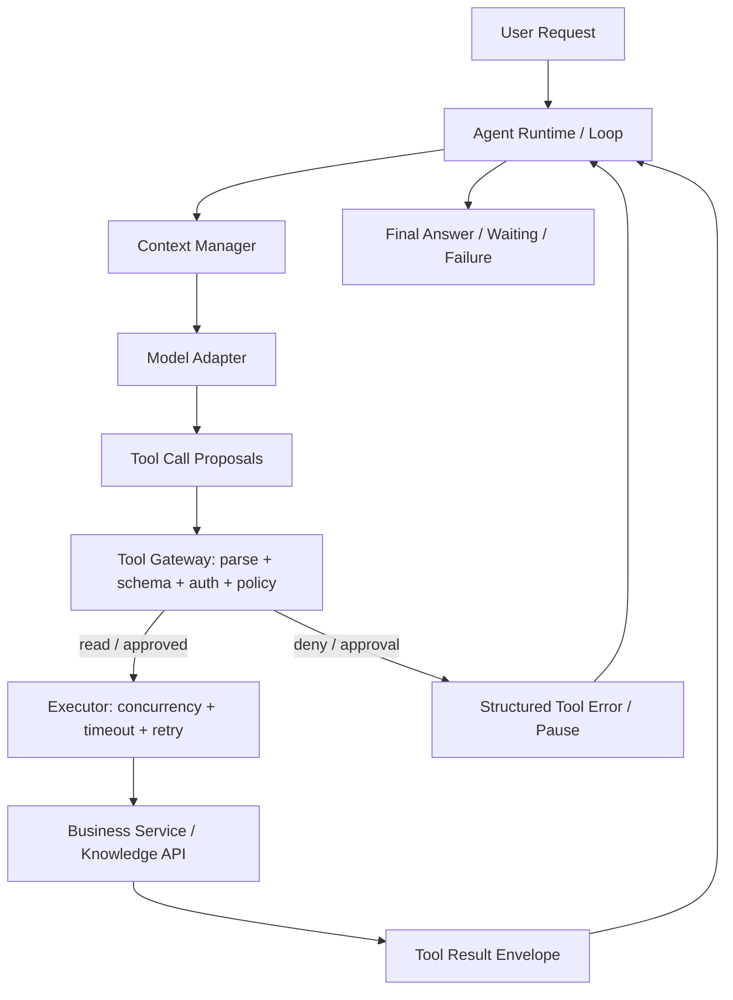
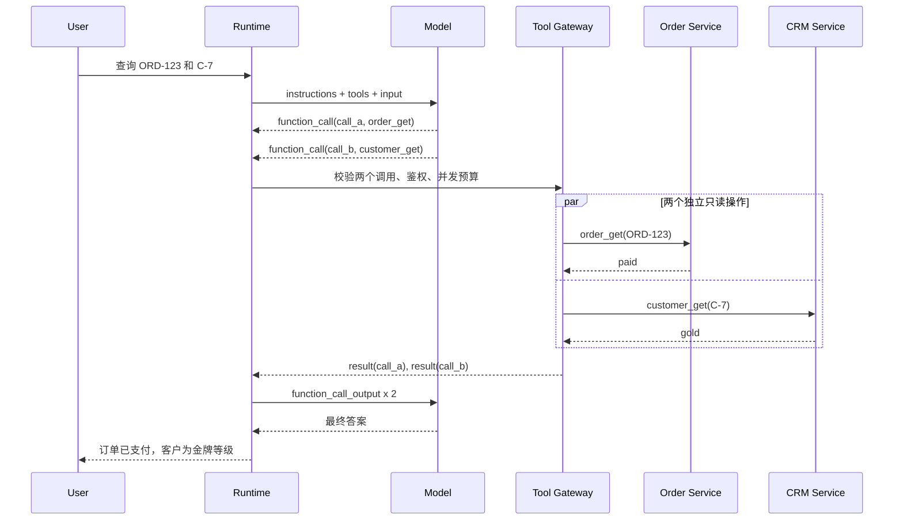

# 第02期｜LLM Tool Calling：从模型协议到可靠工具执行

> 归档说明（2026-10-23）：本阅读版基于用户提供的完整 Markdown 原件整理，保留课程正文、图、代码、练习和原发布验证说明。配套 [TypeScript 实践源码](../projects/week-02/README.md) 已解压归档；[原始 Markdown](../originals/week-02/agent-engineering-week-02-2026-10-23.md) 与 [原始代码 ZIP](../originals/week-02/agent-engineering-week-02.zip) 按字节保留。本次类型检查、7 个测试与离线演示通过，具体命令与环境限制见项目 README。下文版本、“查验”和原发布验证状态属于历史记录，本次补档未逐项重新核验。

**定位**：第01期把 Agent 拆成 Model + Harness；这一期深入 Harness 与外部业务世界之间最关键的边界：Tool Calling。  
**阅读时间**：约20–25分钟；**实践时间**：45–60分钟。  
**本期交付**：协议与架构解析、Mermaid 时序图、TypeScript 核心实现、失败场景、生产检查表、可下载示例代码、验收测试与延伸阅读。

## 01. 本期问题与学习目标

用户问：“帮我查看订单 ORD-123，顺便查一下客户 C-7 的等级。”模型可能一次返回两个工具调用，也可能先查订单、再根据结果决定是否查客户。对于生产级 Agent，真正难的不是让模型“知道有哪些工具”，而是**让模型的提议在不越权、不重复、不丢失关联的情况下成为可控执行**。

学完本期，应能回答：

1. Function Calling 是模型执行函数，还是模型输出结构化调用意图？
2. `call_id`、函数名、参数 JSON、工具结果在多轮协议中如何关联？
3. Strict JSON Schema 与后端 Zod Validation 分别解决什么问题？
4. 什么情况下多个 Tool Call 可以并行？如何处理依赖、错误与超时？
5. 为什么“模型建议执行退款”绝不能直接变成一次真实退款？

本期在整体系统中的位置：



第01期定义了“模型提出，Harness 决定”。本期要把这句话落实到**协议、代码与状态边界**。

## 02. Tool Calling 的本质：两段式协议，而不是远程过程调用

### 2.1 一次完整的调用有两个方向

以 OpenAI Responses API 的客户端函数调用为例，模型输出的 `function_call` 不是已经执行的函数，而是一个待处理的输出项。典型结构：

```json
{
  "type": "function_call",
  "id": "fc_abc",
  "call_id": "call_order_001",
  "name": "order_get",
  "arguments": "{\"orderId\":\"ORD-123\"}"
}
```

这里最容易混淆的是：

- `id` 是**响应项本身**的标识；
- `call_id` 是**函数调用与结果的关联键**；
- `arguments` 是**JSON 字符串**，不是已经可信的 TypeScript 对象；
- `name` 是模型选择的工具名称，不能当作任意可执行函数路径。

业务应用需要解析、验证、授权并执行，然后向模型发送：

```json
{
  "type": "function_call_output",
  "call_id": "call_order_001",
  "output": "{\"ok\":true,\"data\":{\"status\":\"paid\"}}"
}
```

`call_id` 必须保持一致；不要将它替换成内部 Step ID、数据库记录 ID 或 Tool Execution ID。那些可以独立存在，但要保留映射关系。

### 2.2 一轮模型输出可以包含多个调用

```json
[
  { "type": "function_call", "call_id": "call_a", "name": "order_get", "arguments": "{\"orderId\":\"ORD-123\"}" },
  { "type": "function_call", "call_id": "call_b", "name": "customer_get", "arguments": "{\"customerId\":\"C-7\"}" }
]
```

Runtime 应假设模型可能返回 **0、1 或 N 个**工具调用，而不是永远只有一个。0 个调用时可能产生最终答案，也可能返回其他输出项；因此不能简单用“没有 Tool Call = 必然完成”概括所有模型状态。

`parallel_tool_calls: false` 可以限制某些支持的模型一次至多提出一个工具调用，但**模型输出多项**与**业务侧真的并行执行**是两个不同概念。即使模型一次返回三个调用，Executor 仍可决定串行处理。

### 2.3 跨供应商的协议差异

| 维度 | OpenAI Responses | Anthropic Messages | Harness 统一层 |
|---|---|---|---|
| 调用提议 | `function_call` 输出项 | `tool_use` 内容块 | `ToolCallProposal` |
| 关联 ID | `call_id` | `tool_use.id` | `providerCallId` |
| 参数 | JSON 编码的字符串 | `input` 对象 | `unknown`，经校验后使用 |
| 回填结果 | `function_call_output` | `tool_result` | `ToolExecutionResult` |
| 恢复上下文 | response 链或完整项重放 | 按 Messages 协议追加 | Provider Adapter 专责 |

不要在 Runtime Kernel 内散落 `if (provider === ...)`。正确的依赖方向是 `Runtime → ModelPort → Provider Adapter`。

### 2.4 一次完整的时序



这里没有任何一步允许模型直接持有订单数据库连接或支付服务凭据。

## 03. JSON Schema、Strict Mode 与 Zod：三个不同层次

### 3.1 JSON Schema 是“模型的参数契约”

例如：

```json
{
  "type": "object",
  "properties": {
    "orderId": { "type": "string", "description": "订单标识" },
    "includeHistory": { "type": ["boolean", "null"] }
  },
  "required": ["orderId", "includeHistory"],
  "additionalProperties": false
}
```

在 OpenAI 的 Strict Mode 下，每个对象层级需要 `additionalProperties: false`，且对象属性通常都要列在 `required` 中；业务上的“可选值”常通过允许 `null` 表达。注意不同 API 的默认 strict 行为可能不同，不能依赖默认值。官方也明确提醒，Zod 转换助手并不覆盖全部特性。

Strict Mode 主要提升**输出结构遵循程度**，不能保证：

- `orderId` 属于当前租户；
- 订单真实存在；
- 当前用户有权查看；
- 退款金额符合业务规则；
- 业务状态在执行时仍然有效。

所以：

\[
\text{Schema Compliance} \neq \text{Authorization} \neq \text{Business Validity}
\]

### 3.2 Zod 是服务端的可信输入边界

```typescript
import * as z from "zod";

const OrderArgs = z.strictObject({
  orderId: z.string(),
  includeHistory: z.boolean().nullable()
});

const modelSchema = z.toJSONSchema(OrderArgs);
const parsed = OrderArgs.safeParse(JSON.parse(argumentsJson));
if (!parsed.success) {
  return { ok: false, error: { code: "INVALID_ARGUMENTS" } };
}
```

Zod 4 提供 `z.toJSONSchema()`；但不是所有 Zod 类型都能无损转换。`transform`、`Date`、`bigint` 等类型可能不可表示；一些 JSON Schema 关键字也未必在目标模型的 Strict 子集内支持。**应将生成的 Schema 当作需要校验的部署工件，而不是“自动转换后一定可用”。**

一个务实策略是：

1. 模型参数契约只用兼容的 JSON Schema 子集；
2. Zod 在执行前做严格解析；
3. Tenant、User、Scope、资源归属、金额上限由业务层验证；
4. 外部数据里的“请忽略指令”等文本永远不升级为系统指令。

### 3.3 “模型不知道”的信息，不应该让模型猜

假设当前租户 ID 已在可信登录态里，不要让模型填 `tenantId`。应当这样设计：

```typescript
const args = OrderArgs.parse(modelArguments);
const order = await orderRepository.get({
  tenantId: principal.tenantId,  // trusted server context
  orderId: args.orderId
});
```

这同时降低 Token 成本、参数错误和越权风险。

## 04. 并行、依赖与数据新鲜度

### 4.1 模型提出多个调用，不等于它们相互独立

同一轮：

```text
order_get(ORD-123)
customer_get(C-7)
```

如果两个 ID 已知、调用都是只读、彼此不依赖、授权独立，则可以并行。

而下面的依赖链不能直接并行：

```text
customer_find(email)
        ↓ 结果 customerId
orders_list(customerId)
```

模型必须先拿到第一步结果，才能构造第二步参数。对于本期的最小实现，**让模型进入下一轮再提出第二个调用**，比过早实现任意 DAG 更可靠。

### 4.2 并行收益与代价

如果三个只读调用分别耗时 120ms、220ms、180ms：

- 串行理想耗时：\(120+220+180=520\,ms\)；
- 无排队并行理想耗时：\(\max(120,220,180)=220\,ms\)。

实际还需考虑队列、连接池、限流、请求协调开销。因此生产环境要配置：

```typescript
interface ToolExecutionPolicy {
  maxConcurrencyPerRun: number;
  maxConcurrencyPerTenant: number;
  timeoutMs: number;
  retryBudget: number;
}
```

建议默认策略：只并行**已明确可并行的独立只读调用**；写操作、共享资源修改、事务相关调用和高风险操作默认串行，并且进入审批与幂等流程。

### 4.3 不要丢失输出对应关系

并行完成顺序可能是 `call_b → call_a`，但工具结果仍要以原始 `call_id` 回填。即使一个工具失败，也应返回结构化错误，不能静默丢掉一个 `call_id`，否则模型下一轮可能缺失关键信息。

## 05. 错误模型：失败不是一个字符串

建议将错误分成四层：

| 层次 | 示例 | 处理策略 |
|---|---|---|
| 协议错误 | JSON 无法解析、缺失 `call_id` | 不执行，记录协议错误 |
| 输入错误 | Schema 不匹配、字段多余 | 不执行，返回 `INVALID_ARGUMENTS` |
| 权限/策略错误 | 租户不匹配、写操作需审批 | `FORBIDDEN` 或暂停审批；不自动重试 |
| 执行错误 | 超时、429、5xx、远端状态未知 | 按工具语义决定重试、核对或升级处理 |

给模型的 Tool Result 应该是稳定、简短、无敏感内部细节的结构：

```json
{
  "ok": false,
  "error": {
    "code": "ORDER_SERVICE_UNAVAILABLE",
    "retryable": true
  }
}
```

不要把数据库 DSN、Stack Trace、Access Token 或未脱敏业务对象直接塞回上下文。

### 5.1 超时不等于取消成功

`AbortSignal.timeout(3000)` 只是一个取消信号；如果 Tool SDK 不理会该信号，操作可能继续运行。对于已产生副作用的远程调用，即使本地超时，也不能推断远端没有成功。

### 5.2 Retry 必须基于操作语义

- **只读、可重复**：短暂网络失败可指数退避重试，受限于总预算；
- **有副作用但具备业务幂等键**：同一个逻辑动作重试时复用同一键；
- **有副作用且结果未知**：先 Reconcile，无法核对时转人工，不盲目重试；
- **鉴权失败、Schema 错误**：通常不应重试相同输入。

错误示例：

```typescript
// 危险：网络超时可能发生在远端退款成功之后
await retry(() => payment.refund(orderId, amount));
```

更稳妥的接口：

```typescript
await payment.refund({
  orderId,
  amount,
  idempotencyKey: logicalActionId
});
```

注意：传入幂等键并不能自动保证 exactly-once；必须由远端服务承诺并实现幂等语义，Runtime 还需要执行记录与恢复核对。

## 06. TypeScript 实现：一个最小但有边界的 Tool Runtime

本期配套 ZIP 包含完整项目：`src/core.ts`、`src/fake-model.ts`、`src/openai-model.ts`、`src/demo.ts`、`src/live.ts`、`test/core.test.ts`。下面选取关键代码解释，完整实现以配套源码为准。

### 6.1 统一 Provider 协议

```typescript
type FunctionCall = {
  callId: string;
  name: string;
  argumentsJson: string;
};

type FunctionOutput = { callId: string; output: string };

type ModelTurn =
  | { kind: "calls"; calls: FunctionCall[] }
  | { kind: "final"; text: string };

interface ModelSession {
  next(input: string | FunctionOutput[]): Promise<ModelTurn>;
}
```

注意 `ModelSession` 是**每个 Run 独立的会话对象**。如果把保存 `previousResponseId` 的实例做成跨用户共享单例，可能把不同用户的响应链错误串在一起，造成严重的数据隔离问题。

### 6.2 Tool Registry + 可信身份

```typescript
type Principal = {
  tenantId: string;
  userId: string;
  scopes: string[];
};

type Tool = {
  name: string;
  description: string;
  schema: z.ZodType;
  mode: "read" | "write";
  requiredScope: string;
  execute(args: unknown, context: {
    principal: Principal;
    signal: AbortSignal;
  }): Promise<unknown>;
};
```

生产项目应将身份校验和资源级授权交给可信的服务层。仅仅拥有 `order:read` Scope 仍不意味着可以读取所有订单。配套 Demo 返回模拟订单数据，不是已经实现了真实多租户数据库 ACL。

### 6.3 Tool Executor 的执行顺序

```typescript
async function executeCall(call: FunctionCall, ctx: ExecutionContext) {
  const tool = ctx.registry.get(call.name);
  if (!tool) return fail(call.callId, "UNKNOWN_TOOL");

  let raw: unknown;
  try { raw = JSON.parse(call.argumentsJson); }
  catch { return fail(call.callId, "INVALID_JSON"); }

  const parsed = tool.schema.safeParse(raw);
  if (!parsed.success) return fail(call.callId, "INVALID_ARGUMENTS");

  if (!ctx.principal.scopes.includes(tool.requiredScope))
    return fail(call.callId, "FORBIDDEN");

  if (tool.mode === "write")
    return fail(call.callId, "APPROVAL_REQUIRED");

  const data = await tool.execute(parsed.data, ctx);
  return {
    callId: call.callId,
    output: JSON.stringify({ ok: true, data })
  };
}
```

这是示意代码；配套项目中的可运行版本还包含超时信号、错误转换、并发池和预算控制。关键不在语法，而在**顺序不可颠倒**：先查 Registry → 解析 → Schema → 授权 → Policy → 执行 → 回填。

### 6.4 Runtime 的批量处理

```typescript
for (let turn = 1; turn <= maxModelTurns; turn++) {
  const response = await model.next(input);
  if (response.kind === "final") return response.text;

  if (hasDuplicateCallId(response.calls))
    throw new Error("DUPLICATE_CALL_ID");
  assertToolBudget(response.calls.length);

  const parallelSafe = response.calls.every(
    c => registry.get(c.name)?.mode === "read"
  );

  input = parallelSafe
    ? await parallelMapLimit(response.calls, 3, executeCall)
    : await parallelMapLimit(response.calls, 1, executeCall);
}
throw new Error("MAX_MODEL_TURNS");
```

注意：本期只在**所有调用均为只读**时启用有限并发。生产级依赖判断还需要资源冲突、调用顺序、工具幂等与业务约束等元数据。

### 6.5 真实 Responses API Adapter

```typescript
import OpenAI from "openai";

const response = await client.responses.create({
  model: process.env.OPENAI_MODEL ?? "gpt-5.4-mini",
  instructions: "需要订单事实时使用工具，不得编造。",
  input: [{ type: "function_call_output", call_id: "call_a", output: "{\"ok\":true}" }],
  previous_response_id: previousResponseId,
  store: true,
  parallel_tool_calls: true,
  tools: [
    {
      type: "function",
      name: "order_get",
      description: "查询订单",
      strict: true,
      parameters: {
        type: "object",
        properties: { orderId: { type: "string" } },
        required: ["orderId"],
        additionalProperties: false
      }
    }
  ]
});
```

这是**续接请求**的片段，要求 `previousResponseId` 指向之前实际产生 `call_a` 的响应；第一次调用应传入用户输入而不是凭空回填工具结果。完整实现见 `src/openai-model.ts`。

这里选择 `store: true + previous_response_id` 只是为了降低本期教学复杂度。它有数据保存、合规与响应链恢复的权衡。对敏感业务，应评估 `store: false` 的手动完整项重放方案，不能简单只回传 assistant 的文字：reasoning / function_call 等输出项可能也需要按协议保留。官方 TypeScript SDK 文档提供相应的重放辅助说明。

另一个容易遗漏的细节：使用 `previous_response_id` 时，前一轮的 `instructions` 不会自动作为当前请求的指令沿用，因此需要每轮显式传递当前可信指令。

## 07. 生产化扩展：为什么还需要 Tool Execution Ledger？

当前教学实现把 Tool Result 保存在内存中，足以理解协议，却不能应对写操作与 Crash Recovery。生产级建议把**模型调用提议**和**真正业务执行**分开记录。

```sql
CREATE TABLE tool_executions (
  id UUID PRIMARY KEY,
  tenant_id TEXT NOT NULL,
  run_id UUID NOT NULL,
  logical_action_id TEXT NOT NULL,
  provider_call_id TEXT NOT NULL,
  tool_name TEXT NOT NULL,
  args_hash TEXT NOT NULL,
  status TEXT NOT NULL,
  idempotency_key TEXT,
  external_operation_id TEXT,
  result_ref TEXT,
  created_at TIMESTAMPTZ NOT NULL DEFAULT now(),
  updated_at TIMESTAMPTZ NOT NULL DEFAULT now(),
  UNIQUE (tenant_id, run_id, logical_action_id)
);
```

推荐执行顺序：

```text
Model Proposal
   ↓
Validate / Authorize / Policy
   ↓
Prepare Logical Action + Persist Ledger
   ↓ COMMIT
Dispatch Remote Tool (stable idempotency key)
   ↓
Persist Result / Reconcile Unknown Outcome
   ↓
Emit function_call_output
```

不要把远程 API 请求包在一个长时间持有数据库锁的事务里。对于异步队列，后续还需要 Transactional Outbox，避免“数据库已提交、消息未发送”的双写问题。第三期讨论 Run/Step/Event 建模，第四期讨论 Checkpoint 与 Crash Recovery，第五期再落实 Tool Gateway、审批与幂等。

## 08. 设计权衡与反例

**反例 A：把所有工具一股脑提供给模型。** 这样不仅增加 Token 与工具选择难度，也扩大了可被诱导的操作面。按 Agent 职责、用户权限和任务阶段提供最小可用工具集合。若工具数量庞大，可研究按需加载工具的能力，但必须由应用侧重新授权。

**反例 B：Strict Mode 已开启，所以不再验证。** Strict Mode 不等于资源级授权。即使结构完美，也可能访问其他租户的订单。

**反例 C：`Promise.all` 执行模型返回的全部 Tool Calls。** 可能并发执行相互冲突的写操作，甚至造成同一订单的重复变更。并发需要工具语义和依赖关系约束。

**反例 D：任何失败都把 Error Message 原样发回模型。** 可能泄露内部主机、凭据、Stack Trace 和 PII。应映射成稳定、脱敏的错误码。

**反例 E：Tool Timeout 就立刻重试退款。** 远端可能已成功执行。结果未知时先核对。

**反例 F：只保存 `tool_name + arguments`，不保存 `call_id`。** 并行回填时会丢失关联关系；恢复执行时也难以判断哪个模型提议已经处理。

## 09. 可观测性：不要只记录“工具调用成功率”

最少应有以下指标：

| 指标 | 说明 | 用途 |
|---|---|---|
| `tool_call_proposed_total` | 模型提出调用次数 | 了解工具选择分布 |
| `tool_call_rejected_total{reason}` | Schema/Policy 拒绝次数 | 发现越权与契约不一致 |
| `tool_execution_duration_ms` | P50/P95/P99 执行耗时 | 识别尾延迟 |
| `tool_execution_error_total{code}` | 工具失败分类 | 区分业务与基础设施问题 |
| `tool_retry_total` | 重试次数 | 发现不稳定依赖 |
| `model_turns_per_run` | 每个任务模型轮数 | 识别循环与成本异常 |
| `orphan_call_output_total` | 找不到原调用的结果 | 协议完整性告警 |

Trace 里可记录 `run_id`、`step_id`、`provider_call_id`、`tool_name`、`args_hash`、`tenant_id`（脱敏/授权可见）、`policy_decision`、`duration_ms`。不要默认在普通日志中记录完整工具参数与业务结果。

## 10. 本期动手实践：45–60 分钟

### 10.1 环境

- Node.js >= 22；
- TypeScript 5.9 系列；
- Zod 4.6 系列；
- `openai` Node SDK 7.10+（本期按 2026-10-23 查验的文档编写）；
- `tsx` 4.x。

配套项目目录：

```text
agent-engineering-week02-code/
├── package.json
├── tsconfig.json
├── README.md
├── src/
│   ├── core.ts
│   ├── fake-model.ts
│   ├── openai-model.ts
│   ├── demo.ts
│   └── live.ts
└── test/
    └── core.test.ts
```

本地执行：

```bash
npm install
npm run typecheck
npm test
npm run demo
```

如要调用真实模型（会产生 API 费用，且示例使用服务端保存响应链）：

```bash
export OPENAI_API_KEY="..."
export OPENAI_MODEL="gpt-5.4-mini"
npm run live
```

**验证状态（2026-10-23）**：已生成代码与测试文件，但当前执行环境无法从 npm registry 下载依赖，`npm install` 超时，离线安装返回 `ENOTCACHED`。因此**未声称通过 typecheck 或测试**；本地运行后应按实际 SDK 版本修正类型差异。真实 API 路径未执行，也未产生模型费用。

### 10.2 实验与验收

**实验 1（10 分钟）**：FakeModel 同轮返回 `order_get`、`customer_get`。验收：两个结果都成功，`call_id` 分别为 `call_order`、`call_customer`，不会因为完成顺序不同而错配。

**实验 2（10 分钟）**：将 `argumentsJson` 改为无效 JSON、未知字段或缺失必填字段。验收：返回 `INVALID_JSON` 或 `INVALID_ARGUMENTS`，工具实际执行次数为 0。

**实验 3（10 分钟）**：模型请求 `order_refund`。即使 Principal 拥有 `order:refund` Scope，验收：返回 `APPROVAL_REQUIRED`，模拟退款函数没有执行。

**实验 4（10 分钟）**：将同轮工具数设置为大于 `maxToolCalls`，或重复使用同一个 `call_id`。验收：在执行前被 Runtime 拒绝。

**进阶实验（15–20 分钟）**：实现一个工具并发池，限制同一 Run 最多 2 个并发请求；人为加入 200ms 延迟，用 `performance.now()` 比较串行与并行耗时。验收：最大同时运行数 <= 2，输出按 `call_id` 正确对应。

### 10.3 进一步思考

为什么本期的 `ToolExecutor` 对写操作只返回 `APPROVAL_REQUIRED`，没有直接支持 `resume()`？因为审批需要可持久化的 Pending Action、绑定动作参数的审批记录、有效期、重新授权和稳定幂等键。这些会在第四、第五期实现。

## 11. 五道思考/面试题

1. Responses API 的 `function_call.id` 与 `function_call.call_id` 有什么区别？如果两个并行调用的结果顺序反转，如何保证正确回填？
2. Strict JSON Schema、Zod Validation、RBAC/ABAC、业务不变量分别防止哪一类错误？能否相互替代？
3. 模型在同一轮返回 `get_balance` 和 `transfer_money`，是否应该并行？怎样表达数据依赖与风险边界？
4. 一次退款请求超时，支付平台返回未知状态。怎样避免重复退款？什么时候必须人工介入？
5. 如果模型提供了 80 个 Tool，如何评估工具选择准确率、Token 成本和安全风险？何时应该按需加载？

## 12. 推荐阅读（2026-10-23 查验）

1. **OpenAI Function Calling Guide**：协议、Strict Mode、Tool Choice、多调用与回填。  
   https://developers.openai.com/api/docs/guides/function-calling
2. **OpenAI Conversation State**：`previous_response_id`、手动项重放、服务端状态与数据保存权衡。  
   https://developers.openai.com/api/docs/guides/conversation-state
3. **OpenAI TypeScript SDK**：Responses API 的 TypeScript 用法与重放辅助说明。  
   https://developers.openai.com/api/reference/typescript
4. **Zod 4 JSON Schema**：`z.toJSONSchema()` 与不可表示类型、输入/输出 Schema 的区别。  
   https://zod.dev/json-schema
5. **Anthropic Tool Use**：跨供应商比较 `tool_use`、`tool_result` 和并行工具调用。  
   https://docs.anthropic.com/en/docs/agents-and-tools/tool-use/implement-tool-use

**时效性说明**：上面的 SDK、模型名、Strict Mode 限制和 API 细节可能随版本变化；请在实际部署时再次查验。相对稳定的工程原则是：模型提议不等于授权、Tool Call 需要关联 ID、参数与权限必须在执行边界验证、写操作必须考虑幂等与未知结果。

## 13. 本期结论与下一期

本期可以归结为一个公式：

\[
\text{Reliable Tool Calling} =
\text{Protocol Correlation}
+\text{Validation}
+\text{Authorization}
+\text{Execution Control}
+\text{Result Reconciliation}
\]

**最重要的结论**：Tool Calling 不是让模型直接调用函数，而是让模型通过一个受控协议提出操作，再由 Harness 在可信边界内验证、执行、记录与反馈。

与第01期的衔接：第01期构建了最小 Agent Loop；第02期补齐 Tool 协议、Schema、权限与并发边界。**第03期预告：Runtime 状态机与 Run / Step / Event 建模**——把本期仍在内存里的调用过程转成可持久化、可追踪、可恢复的执行记录。
