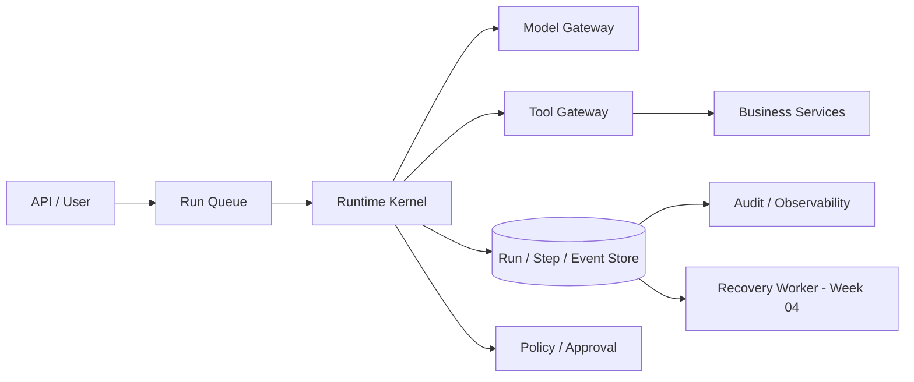
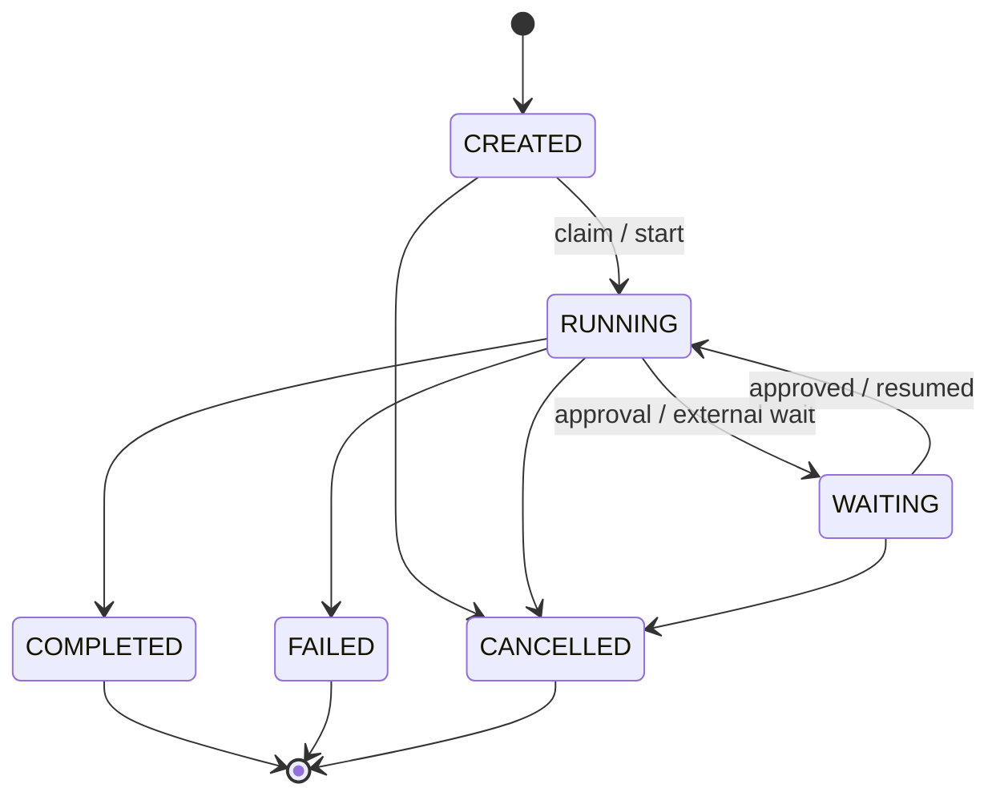
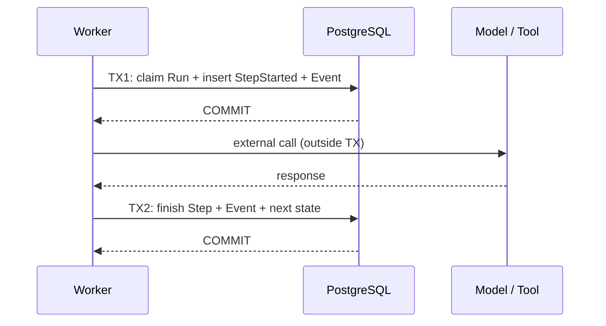

# 第03期｜Agent Runtime 状态机：Run / Step / Event 建模与持久化设计

**阅读：约 20–25 分钟｜动手：45–60 分钟｜前置：Week 01–02**

> 这一期只解决一个问题：当 Agent 从一次模型调用升级为持续多步执行的业务任务时，如何把“正在做什么、做过什么、下一步能否继续”变成系统可查询、可约束、可审计的事实？

[本期 TypeScript 项目](../projects/week-03/README.md) 包含 FakeModel、内存 Store、状态迁移、Step/Event、PostgreSQL 表结构和 10 个离线测试。**内存教学版不具备崩溃恢复；SQL 仅为持久化设计骨架。**

## 01. 在整体架构中的位置与学习目标

第01期明确 `Agent = Model + Harness`：模型负责提议，Harness 负责执行。第02期把 Tool Calling 拆成提议、Schema、授权、工具执行和结果回填。但我们仍有一个隐含假设：Node.js 进程从头到尾不崩溃，而且只有一个 Worker。

现实中的 Agent 可能执行几十步、等待人审批数小时、经历部署重启、外部 API 超时或队列重投。把 `messages[]` 放在进程内存中，会在第一次异常重启时丢失执行事实。



学完后应能回答：为什么需要三个实体而不是一个 `status` 字段？状态与事件怎样在同一事务中保持一致？CAS 能防什么、不能防什么？模型调用超时与工具写入超时为什么不是同一类恢复问题？

## 02. Run、Step、Event：三个不同维度

### 2.1 Run 是任务生命周期，不是 HTTP 请求

Run 表示一个有明确起点、目标、租户与执行策略版本的任务实例。一次 HTTP 请求可以创建 Run 后立即返回 `202 Accepted + runId`，之后通过 SSE/轮询获取状态。Run 不应直接绑定某个 Worker、某条 TCP 连接或某次模型 response ID。

建议字段：`run_id`、`tenant_id`、`agent_version`、`status`、`version`、`created_at`、`updated_at`、`budget`、`deadline`、`result_ref`、`error_code`。生产环境还应记录模型/提示词/工具注册表版本或不可变快照，以免重启后执行语义悄然改变。

### 2.2 Step 是可定位的执行边界

Step 是一次明确的模型调用、工具执行或等待动作，具有 `step_id`、`run_id`、`seq`、`kind`、`status`、`input_ref`、`output_ref`、`attempt`、`started_at`、`finished_at`。Step 不等于模型供应商的 `call_id`：后者是协议关联键；Step 是本系统的执行事实。重试同一业务动作时，`attempt` 可能变化，而 `logical_action_id` 应稳定。

建议把 Step 拆成**意图持久化**和**结果持久化**两个原子提交点；外部调用不能放在持有数据库行锁的长事务内。一个 Step 可以在 `STARTED` 停留很久，这不是“自动可重试”的充分理由。

### 2.3 Event 是状态变化事实，不是另一份可任意更新的状态

Event 记录 `RunCreated`、`RunStatusChanged`、`StepStarted`、`StepSucceeded`、`StepFailed` 等不可变事实。事件有每个 Run 内单调递增的 `seq`，用于回放、审计和增量 UI 推送。不要依赖不同机器的墙上时钟或 UUID 排序来决定事件顺序。

**三者关系：** `Run = 当前快照`，`Step = 执行记录`，`Event = 变化历史`。`Run` 的当前状态可以用于高效查询；`Event` 用于解释它为什么到达此状态。仅存 Event 的纯事件溯源不是唯一正确方案；对于一般业务 Agent，快照 + append-only 事件往往更容易运维。

| 需求 | Run | Step | Event |
| --- | --- | --- | --- |
| 查询任务是否完成 | 主 | 辅 | 可重放 |
| 找出哪次工具超时 | 辅 | 主 | 审计 |
| 追踪状态何时变化 | 快照 | 辅 | 主 |
| Worker 重启恢复 | 当前指针 | 未完成边界 | 事件佐证 |
| UI 断线重连 | 状态摘要 | 步骤明细 | `seq` 增量 |

## 03. 状态机不是一个随意更新的字符串



本期的 `WAITING` 是领域状态，表示任务被有意暂停。`RECOVERING` 更适合建模为 Worker/协调器阶段，或额外的内部状态；不能为了可视化而让外部 API 的终态语义模糊。对业务可见的终态通常为 `COMPLETED / FAILED / CANCELLED`，**一旦进入终态，禁止原地回到 RUNNING**；补偿或重试应新建 Run/Attempt 并保留关联。

核心不变量：

1. 状态迁移必须通过允许的有向边，不能任意 `UPDATE status = ?`。
2. 一个 Run 的 `version` 在每次状态迁移时递增，旧版本提交应失败。
3. 同一 Run 内 Step 的 `seq` 单调递增，事件的 `seq` 独立单调递增。
4. 同一 Run 同一时刻最多一个**串行内核**的活动 Step；并行工具需扩展为 Step Group/DAG，不能沿用这个简化约束。
5. 终态不可变；状态更新与对应事件写入必须处于同一数据库事务。
6. 所有读取、更新都带可信 `tenant_id` 约束；模型输入中的租户 ID 不可信。

### 一个失败反例

```ts
// 错误：没有 CAS、没有合法迁移检查、没有审计事件。
await db.query('UPDATE agent_runs SET status=$1 WHERE id=$2', ['COMPLETED', runId]);
```

两个 Worker 可以先后把同一个 Run 标记为完成和失败；UI 只看到最终覆盖结果，无法解释发生了什么。

## 04. 两次提交边界：为什么不能用一个事务包住 LLM 调用



外部模型/工具调用可能耗时数秒至数分钟。若事务从调用前一直持有到响应后，会长时间占用连接与锁，增加死锁和资源耗尽风险。正确策略是短事务记录“准备执行/已开始”，释放事务后调用外部服务，随后用新事务记录结果。

但这也引入一个不可消除的窗口：**外部调用成功，TX2 尚未提交，Worker 崩溃。** 对只读调用可以在业务允许时重试；对写操作不能默认重试。Event Log 不能证明远端操作没发生。第04/05期会增加 lease、fencing token、幂等 ledger、UNKNOWN 结果核对。

## 05. PostgreSQL 建模：关系约束与可查询性优先

本期项目提供 [`schema.sql`](../projects/week-03/schema.sql)，下面是关键结构（完整迁移以项目文件为准）：

```sql
CREATE TABLE agent_runs (
  id uuid PRIMARY KEY,
  tenant_id text NOT NULL,
  agent_version text NOT NULL,
  input_text text NOT NULL,
  status text NOT NULL,
  version bigint NOT NULL DEFAULT 0,
  step_seq bigint NOT NULL DEFAULT 0,
  event_seq bigint NOT NULL DEFAULT 0,
  output_text text,
  error_text text,
  created_at timestamptz NOT NULL DEFAULT now(),
  updated_at timestamptz NOT NULL DEFAULT now()
);
CREATE TABLE agent_steps (
  id uuid PRIMARY KEY,
  run_id uuid NOT NULL REFERENCES agent_runs(id),
  seq bigint NOT NULL,
  kind text NOT NULL,
  status text NOT NULL,
  input_json jsonb NOT NULL,
  output_json jsonb,
  error_text text,
  UNIQUE (run_id, seq)
);
CREATE UNIQUE INDEX one_active_step_per_run
  ON agent_steps(run_id) WHERE status = 'STARTED';
CREATE TABLE agent_events (
  id uuid PRIMARY KEY,
  run_id uuid NOT NULL REFERENCES agent_runs(id),
  seq bigint NOT NULL,
  event_type text NOT NULL,
  payload_json jsonb NOT NULL,
  occurred_at timestamptz NOT NULL DEFAULT now(),
  UNIQUE (run_id, seq)
);
```

`jsonb` 适合存结构化元数据和小型结果，不适合无限制塞入长对话、完整文档或敏感响应。大内容使用对象存储与内容哈希引用；对个人信息、工具凭证做脱敏与保留期控制。生产中应补齐跨租户查询索引、审计访问策略、加密和清理策略。

### 5.1 CAS：状态版本的原子检查

```sql
UPDATE agent_runs
SET status = $3, version = version + 1, updated_at = now()
WHERE id = $1 AND version = $2 AND status = $4
RETURNING version;
```

如果 `RETURNING` 没有行，说明前置状态或版本不匹配，应返回冲突，而不是直接再次覆盖。对于状态迁移和事件插入，必须在同一事务里完成；事件序号可以通过更新 Run 的 `event_seq` 获取，再写入 `agent_events`。同时要注意：**CAS 保护的是数据库中的状态竞争，不是外部工具执行的 exactly-once 保证。**

### 5.2 事务示意

```ts
// 使用 node-postgres 时的事务形状；本期未连接真实 PG 验证。
const client = await pool.connect();
try {
  await client.query('BEGIN');
  const updated = await client.query(
    `UPDATE agent_runs SET status=$3, version=version+1,
       event_seq=event_seq+1, updated_at=now()
     WHERE id=$1 AND version=$2 AND status='CREATED'
     RETURNING event_seq`, [runId, expectedVersion, 'RUNNING']);
  if (updated.rowCount !== 1) throw new Error('VERSION_CONFLICT');
  await client.query(
    `INSERT INTO agent_events(id,run_id,seq,event_type,payload_json)
     VALUES ($1,$2,$3,'RunStatusChanged',$4)`,
    [crypto.randomUUID(),runId,updated.rows[0].event_seq,JSON.stringify({to:'RUNNING'})]);
  await client.query('COMMIT');
} catch (e) { await client.query('ROLLBACK'); throw e; }
finally { client.release(); }
```

这里的 `pool` 是 `pg.Pool` 实例，代码片段是说明事务边界，不包含完整连接、租户过滤和迁移管理，**不能直接作为已验证的生产实现**。`READ COMMITTED` 下 `UPDATE ... WHERE version=?` 能安全拒绝已被其他事务更新的旧版本；需要多行不变量时应考虑行锁或更高隔离级别并处理序列化失败。

## 06. TypeScript 内核：把状态规则变成代码

源码：[`src/core.ts`](../projects/week-03/src/core.ts)。它是无外部依赖的教学版，使用 Node.js 22 的全局 `crypto.randomUUID()` 与 `structuredClone()`。

```ts
export type RunStatus =
  | 'CREATED' | 'RUNNING' | 'WAITING'
  | 'COMPLETED' | 'FAILED' | 'CANCELLED';
export type StepKind = 'MODEL' | 'TOOL';
export type StepStatus = 'STARTED' | 'SUCCEEDED' | 'FAILED';
export type Run = {
  id: string; tenantId: string; agentVersion: string; input: string;
  status: RunStatus; version: number; stepSeq: number; eventSeq: number;
  output?: string; error?: string;
};
export type Step = {
  id: string; runId: string; seq: number; kind: StepKind;
  status: StepStatus; input: unknown; output?: unknown; error?: string;
};
export type RuntimeEvent = {
  id: string; runId: string; seq: number; type: string;
  payload: unknown; occurredAt: string;
};
```

合法迁移显式列举，而不是散落在不同 Handler 中：

```ts
const transitions: Record<RunStatus, ReadonlySet<RunStatus>> = {
  CREATED: new Set(['RUNNING', 'CANCELLED']),
  RUNNING: new Set(['WAITING', 'COMPLETED', 'FAILED', 'CANCELLED']),
  WAITING: new Set(['RUNNING', 'CANCELLED']),
  COMPLETED: new Set(), FAILED: new Set(), CANCELLED: new Set()
};
```

`RunStore` 是内核与持久化的边界：

```ts
export interface RunStore {
  create(input: { tenantId: string; agentVersion: string; prompt: string }): Promise<Run>;
  get(id: string): Promise<Run>;
  transition(id: string, expectedVersion: number, to: RunStatus,
    data?: { output?: string; error?: string }): Promise<Run>;
  beginStep(id: string, kind: StepKind, input: unknown): Promise<Step>;
  finishStep(id: string, stepId: string,
    result: { ok: true; output: unknown } | { ok: false; error: string }): Promise<Step>;
  steps(id: string): Promise<Step[]>;
  events(id: string): Promise<RuntimeEvent[]>;
}
```

### 6.1 最小执行环

```ts
// 结构化摘录；完整实现包含失败 Step 记录与 Run 终态处理。
for (let i = 0; i < maxTurns; i++) {
  const modelStep = await store.beginStep(runId, 'MODEL', { history });
  const turn = await model.next(history);
  await store.finishStep(runId, modelStep.id, { ok: true, output: turn });
  if (turn.kind === 'final') {
    const run = await store.get(runId);
    return store.transition(runId, run.version, 'COMPLETED', { output: turn.text });
  }
  const toolStep = await store.beginStep(runId, 'TOOL', turn);
  const result = await tools.get(turn.name)!.execute(turn.args, run.tenantId);
  await store.finishStep(runId, toolStep.id, { ok: true, output: result });
  history.push({ role: 'tool', callId: turn.callId, output: result });
}
```

为什么先 `beginStep` 再调用模型？因为发生超时时，至少可以知道曾发起过哪个 Step。但本期 `history` 仍然在内存中；**只有把每轮模型输入、输出和工具结果按稳定格式持久化，才可能安全地恢复上下文**。对于并行工具调用，需要从单个活动 Step 扩展为 Step Group/DAG，并定义 join 语义。

### 6.2 为什么 FakeModel 是必须的？

```ts
const model = new FakeModel([
  { kind: 'tool', callId: 'call-1', name: 'order.get', args: { orderId: 'ORD-123' } },
  { kind: 'final', text: 'ORD-123 已支付。' }
]);
```

FakeModel 让测试可以断言精确的事件序列和终态，而不受模型随机性、成本和网络波动影响。它验证的是 Runtime 规则，不代表真实模型协议已完成集成测试。生产环境还需 Adapter 合约测试、真实 API 的少量 smoke test 和 Evals。

## 07. 四种必须区分的故障

| 故障点 | 本地可以确认什么 | 安全处理方向 |
| --- | --- | --- |
| `StepStarted` 之前崩溃 | 没有已提交执行意图 | 可以重新领取 Run，但需先有分布式领取协议 |
| `StepStarted` 之后、调用模型之前崩溃 | 有开始记录，无远端请求确认 | 由租约与超时策略接管；模型调用可按语义重试 |
| 只读工具完成后、结果提交前崩溃 | 外部只读结果丢失 | 允许时重读，注意数据快照可能变化 |
| 退款成功后、结果提交前崩溃 | 本地结果未知 | **不能盲目重试**；凭稳定业务键查询远端或人工核对 |

注意：`FAILED` 不等于“所有外部操作都失败了”，`CANCELLED` 不等于“远端副作用已撤销”。因此终态与外部操作账本必须分开建模。一次 Run 失败时可能存在已经成功的写操作，需要补偿或人工处置。

### 7.1 为什么乐观锁不够

`version` CAS 只能阻止两个事务同时改写同一条 Run。它不能阻止 Worker A 在租约过期后仍继续调用远端工具，同时 Worker B 已经接管。下一期引入 `lease_owner`、`lease_expires_at` 和单调递增 `fencing_token`；执行器在关键操作前验证 token，外部系统若支持也应校验。

### 7.2 Event Log 与 Outbox

`agent_events` 作为审计记录并不自动保证事件已送达 Kafka/SSE。若数据库提交成功但消息发布失败，消费者会漏事件。常见方案是**事务 Outbox**：在同一事务中写状态与待发布消息，再由异步投递器至少一次发送，消费者使用事件 ID 去重。不要把“事件入库”误称为“通知已经送达”。

## 08. 工程设计权衡与边界

**Snapshot + Events vs 纯 Event Sourcing：** 纯 Event Sourcing 提供可重放性，但增加 schema 演化、投影一致性和重放成本。多数 Agent 系统先用 Run/Step 当前表 + append-only Event 即可；只有确有历史重建需求时再引入完整事件溯源。

**每步同步写库 vs 批量缓冲：** 每步持久化增加 I/O，但对长任务是恢复边界。可以异步记录非关键遥测，但状态迁移、执行意图和写操作账本不能只靠进程内缓冲。

**Step 的粒度：** 太粗无法定位问题，太细导致数据库爆炸。建议模型请求、工具调用、审批等待作为一级 Step；Token streaming、内部函数调用作为 Trace Span，不必全部成为业务 Step。

**数据保留：** Tool 输出可能包含个人数据、商业秘密或 Prompt Injection 内容。存储前做字段级脱敏，限制大小，按租户设保留期；Audit 不等于无限期保存原始对话。

**版本漂移：** Run 创建时绑定 Agent 配置/Prompt/Tool Schema 的版本；恢复时不能默默使用最新策略，否则相同 Run 可能在中途改变行为。

## 09. 生产实践检查表与常见坑

- 将 Run、Step、Event 的创建/更新放在可验证的短事务里；事件 `seq` 由数据库事务分配。
- `UPDATE ... WHERE version = ?` 的受影响行数必须检查；冲突不能静默覆盖。
- 所有 Store 操作都必须从服务端身份注入 `tenant_id`，不能由 LLM 提供。
- `StepStarted` 不等于远端请求一定发出；`ToolTimeout` 不等于业务失败。
- 模型 response ID、Step ID、逻辑业务 Action ID、幂等键分别建模。
- 不在数据库事务内等待模型、外部 API 或人工审批。
- 为每个 Run 设置轮次、时间、Token、费用预算；终态保持不可变。
- Event Payload 使用版本化结构；跨版本消费要兼容旧事件。
- 观察 `stuck RUNNING`、`STARTED step age`、CAS 冲突、重复执行、Event 投递滞后等指标。
- 分布式 Worker 必须增加 lease/fencing，不能把单进程 MemoryStore 的测试通过当作分布式正确性证明。

## 10. 45–60 分钟动手实践与验收

项目：[`projects/week-03/`](../projects/week-03/README.md)。

```bash
cd projects/week-03
npm install
npm run typecheck
npm test
npm run demo
```

若环境已预装 TypeScript 且 npm 依赖不可下载，可在项目目录运行：

```bash
tsc --noEmit
tsc
node --test test/*.test.mjs
node dist/demo.js
```

**练习 A（15 分钟）：** 给 `RunStatus` 新增 `WAITING` 的业务约束测试：从 `CREATED` 直接进入 `WAITING` 必须失败；从 `RUNNING` 进入 `WAITING` 可以成功；从 `WAITING` 恢复到 `RUNNING` 必须产生 Event。

**练习 B（15 分钟）：** 模拟模型抛错，确认 `StepFailed` 和 `RunStatusChanged(to=FAILED)` 都被记录；再尝试二次结束同一 Step，必须返回冲突。

**练习 C（15–30 分钟）：** 根据 `schema.sql` 编写一个真正的 `PgRunStore.transition()`，用事务实现 CAS + Event 写入，并增加并发冲突测试。没有本地 PostgreSQL 时，提交代码和 SQL 设计说明即可，但**不能声称数据库测试已通过**。

验收条件：10 个原有测试通过；`Run` 终态不可变；事件序号连续；旧版本迁移被拒绝；模型和工具错误产生可定位 Step；演示输出 3 个 Step（MODEL → TOOL → MODEL）及完成状态。

## 11. 思考题 / 面试题

1. 为什么 `Run.status`、`Step.status`、`RuntimeEvent` 不能互相替代？如果只保留 Event Log，恢复成本和查询成本如何变化？
2. `READ COMMITTED` 下 CAS 更新为什么能阻止 lost update？它为什么不能保证远端退款 exactly-once？
3. Worker 在 `StepStarted` 后崩溃，怎样判断这个 Step 可以重试？只读查询与转账写入的策略有什么本质不同？
4. 一个模型轮次产生 5 个并行 Tool Call 时，如何扩展 Step、依赖图、join 和失败策略？
5. 为什么“状态更新与 Event 入库同事务”仍不足以保证消息已投递到下游？Outbox 消费者怎样去重？

## 12. 本期核对的参考资料（2026-10-30）

以下是稳定设计原则的官方来源；版本适用性以部署时的文档和实际环境为准：

1. PostgreSQL 18 — Transaction Isolation：`READ COMMITTED`、可重复读与可序列化语义。https://www.postgresql.org/docs/18/transaction-iso.html
2. PostgreSQL 18 — Explicit Locking：行锁、死锁、advisory locks、锁持有范围。https://www.postgresql.org/docs/18/explicit-locking.html
3. PostgreSQL 18 — Concurrency Control：MVCC、隔离级别和锁策略总览。https://www.postgresql.org/docs/current/mvcc.html
4. Node.js — Test Runner：使用内置 `node --test` 做确定性 Runtime 测试。https://nodejs.org/api/test.html
5. node-postgres — Transactions：事务中的语句必须使用同一个 client；不能在事务内混用 `pool.query`。https://node-postgres.com/features/transactions

**稳定原则：** 状态机显式化、短事务、CAS、Step 执行意图、事件不可变、外部写操作的未知结果核对。**时效细节：** 当前 PostgreSQL 文档版本为 18；本期教学项目在 Node.js 22.16.0 与 TypeScript 5.8.3 上验证；`pg` 适配器未实现与运行，数据库示例不代表线上集成已验证。

## 13. 本期验证记录与下一期

本期在受限执行环境中实际运行：`npm run typecheck` **通过**、`npm test` **10/10 通过**、`npm run demo` **通过**（底层使用预装的全局 TypeScript 5.8.3）。没有运行 `npm install`、真实 PostgreSQL 迁移、真实 LLM API、CI、跨进程并发或外部业务集成。`MemoryStore` 在进程退出后会丢失全部数据，不能被称为持久化 Runtime。

与第02期的联系：Tool Calling 解决“如何验证并执行模型提议”，本期解决“执行前后如何记录可信状态与历史”。**第04期｜Pause / Resume、Checkpoint、乐观锁与 Crash Recovery** 将在这些状态边界上增加租约、恢复扫描、重建上下文、UNKNOWN 结果核对和审批恢复，形成可跨进程重启的执行闭环。
