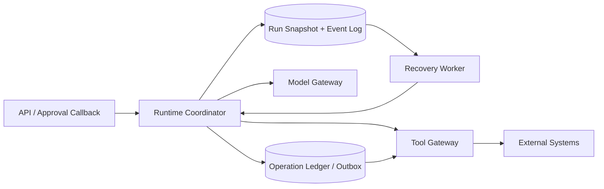
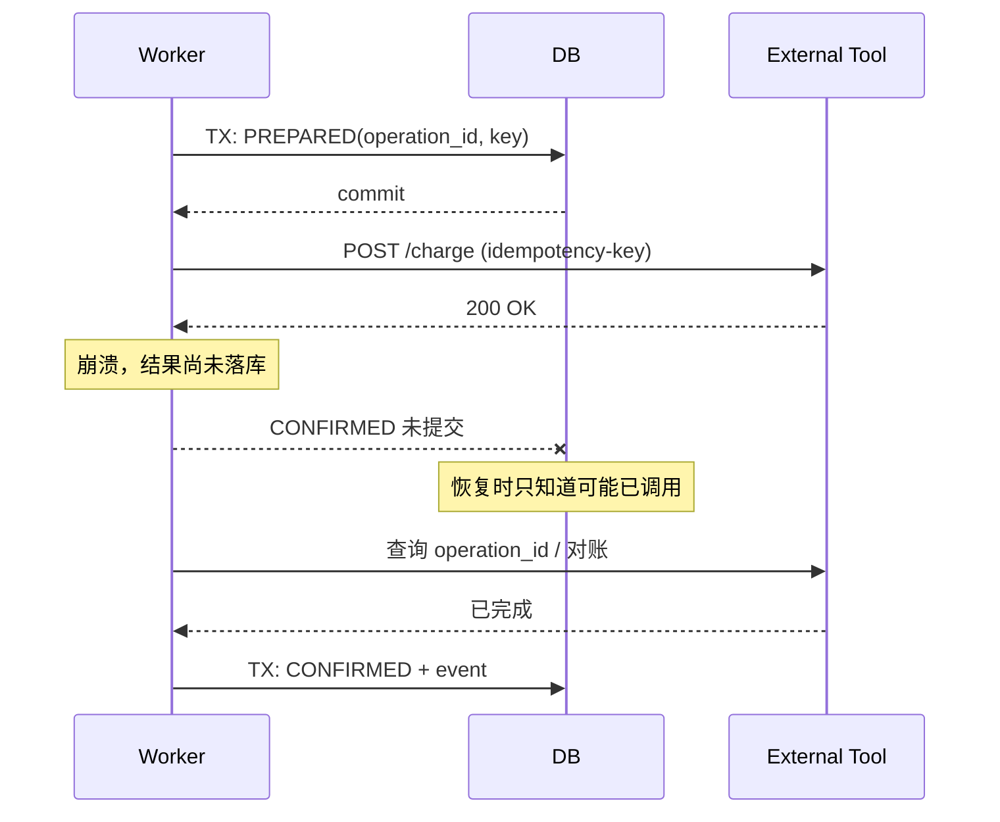
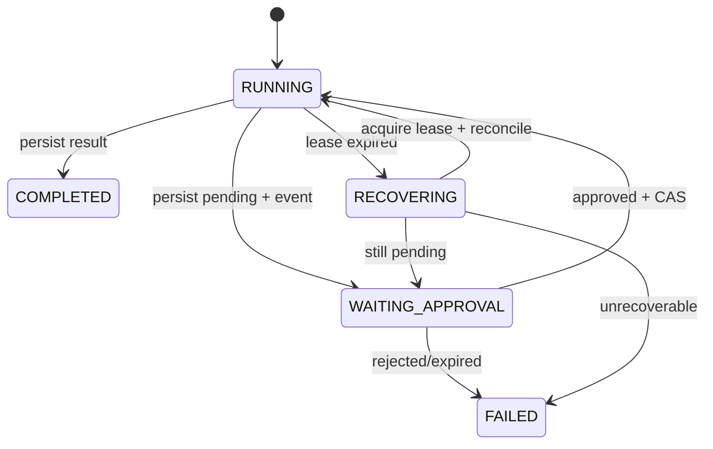

# 第04期｜Pause / Resume、Checkpoint、乐观锁与 Crash Recovery

> 核心问题：**Agent 在执行中途停下来、机器崩溃、人工审批隔天才回来时，怎样保证不会丢状态、重复发起外部写操作，或让两个 Worker 同时接管同一 Run？**

本期接续 [第03期：Run / Step / Event](../lessons/agent-engineering-week-03-2026-10-30.md)。第03期建立了可描述的状态机；第04期要把它变成可恢复的协议。最重要的认识是：**保存 JSON 不等于可靠恢复；恢复必须回答“最后一个已提交的决定是什么、哪些外部动作可能已经发生、谁有权继续执行”。**

## 1. 学习目标与架构位置

完成本期应能：区分暂停、恢复、重试、重放；定义安全 checkpoint 边界；用 CAS 处理并发更新；用 lease + fencing 处理旧 Worker；解释为什么外部工具的 exactly-once 不可由 Agent Runtime 单方面保证；设计 Crash Recovery 的扫描与对账流程。

Agent Runtime 处在模型调用、工具执行和持久化之间。它不仅是一个 while loop，更是**状态所有权、事件提交、外部副作用协调器**。如果一个 Run 正在等待用户确认支付，不能继续占着一个 Node.js Promise 直到明天：进程和连接会消失。必须把等待变成数据库里的持久状态，让新的请求重新驱动。



这张图中的 DB 和 Operation Ledger 应处于可协调的事务边界内；对外部系统的调用则无法被本地数据库事务覆盖。**真正难的不是恢复模型推理，而是恢复“模型决策之后、外部副作用之前/之后”的不确定性。**

## 2. 四个概念：Pause、Resume、Retry、Replay

**Pause**：Run 到达等待条件（人工审批、异步回调、配额、长时间任务），持久化 `WAITING_*` 状态并释放 Worker。它是业务状态，不是 JavaScript 的 `await sleep()`。

**Resume**：读取已提交 checkpoint，验证外部事件的身份、版本和唯一键，然后从确定的 cursor 继续。Resume 不应重新生成已经确定的工具参数；否则审批者看到的和执行的可能不同。

**Retry**：某个失败步骤重新尝试，可能产生第二次网络请求。它需要幂等键、预算、退避和终止条件。Retry 不等于 Resume。

**Replay**：重建状态，可能只是重新折叠事件，也可能重新执行逻辑。**重放事件不应重放真实外部写操作。** 事件必须有稳定顺序、schema version 和来源；否则重建结果会随代码升级改变。

### 2.1 安全的 Checkpoint 是什么

最小快照字段建议：`run_id`、`version`、`status`、`cursor`、`pending_action`、`checkpoint_schema_version`、`model_context_ref`、`lease_epoch`、`updated_at`。事件表单独记录不可变的 `seq/kind/payload`；重要状态转移在**同一事务**更新快照并插入事件。大体积对话上下文可放对象存储，以内容哈希引用；不能把易失内存里的模型历史当成持久 checkpoint。

Checkpoint 应放在可恢复边界，例如：工具参数已验证、审批请求已登记、工具执行结果已持久化、模型输出已提交。不要在工具调用前只写 `RUNNING`，调用成功后直接返回用户却不记账；崩溃后就不知道是否已发送。

### 2.2 最危险的崩溃窗口



这个窗口是**UNKNOWN outcome**：网络超时、进程终止、响应丢失都不能证明“调用失败”。盲目重试可能重复扣款、重复发邮件。正确策略依赖工具契约：优先服务端幂等键；否则查询远端业务 ID；无法查询时停在 `UNKNOWN` 等待人工或补偿流程。补偿不等于回滚，例如撤销订单无法让用户忘记已收到的邮件。

## 3. 乐观锁：解决并发写，不解决 Worker 所有权

两个审批回调同时读取 version=7，如果都写 version=8，会发生 lost update。CAS 条件更新：

```sql
BEGIN;
UPDATE agent_runs
SET version = version + 1,
    status = 'RUNNING',
    snapshot = $3,
    updated_at = now()
WHERE run_id = $1 AND version = $2
RETURNING version;
-- 必须检查恰好返回一行；0 行 => 冲突，ROLLBACK 后重新读取
INSERT INTO agent_events(run_id,seq,kind,payload)
VALUES ($1,$4,'APPROVED',$5);
COMMIT;
```

这个 SQL 是事务模式示意；应用层必须保证没有命中 UPDATE 时**不插入事件**，并保证 `seq` 唯一。单机内存里的 Map CAS 只能验证算法；真实多进程必须由 PostgreSQL 等共享持久层保证原子性。

CAS 是“这次写入是否基于最新版本”的保护，**不是“哪个 Worker 现在拥有执行权”**。一个旧 Worker 可能卡在长时间模型调用中，租约到期后新 Worker 接管；旧 Worker 随后醒来。必须有 `lease_epoch` 单调递增的 fencing token，所有提交检查 epoch：

```sql
-- 示例：接管过期租约，epoch 每次递增
UPDATE agent_runs
SET lease_owner = $worker_id,
    lease_epoch = lease_epoch + 1,
    lease_expires_at = now() + interval '30 seconds'
WHERE run_id = $run_id
  AND (lease_expires_at IS NULL OR lease_expires_at < now())
  AND status = 'RUNNING'
RETURNING lease_epoch;
```

所有后续 DB 写入都带 `WHERE lease_epoch=$acquired_epoch`。但注意：**数据库 fencing 无法阻止已经发往外部系统的请求**；工具网关也需要核对 operation ID、权限和幂等键。对于没有 fencing 能力的外部系统，应使用 operation ledger 和对账补救。

## 4. 状态转移设计：审批不是一个 Boolean

推荐审批记录包括 `approval_id`、`run_id`、`step_id`、`tool_name`、`canonical_args_hash`、`requested_by`、`expires_at`、`decision_by`、`decision_at`、`decision_idempotency_key`。审批对象必须绑定**具体已冻结的参数**；不能只保存“用户允许调用 sendEmail”，然后恢复时让模型重新选择收件人。



状态设计要避免把 `WAITING_APPROVAL` 和 `RUNNING` 同时视为可执行；恢复扫描只接管满足条件的 Run。审批回调需验证用户身份、租户隔离、权限、签名/会话、重复请求和过期时间。审批决策也应有不可变审计事件。

## 5. 可运行的 TypeScript 教学实现

配套代码位于 [projects/week-04/](../projects/week-04/README.md)。环境为 Node.js >=22.16、TypeScript 5.9、`@types/node` 22。示例只使用 Node 内建 `node:test`、文件系统和内存 Store；不需要模型密钥。**`FileStore` 仅演示跨 Runtime 实例恢复，不是生产级持久层。**

核心协议如下（完整源码、测试、演示见项目目录）：

```ts
export type Status = 'RUNNING' | 'WAITING_APPROVAL' | 'COMPLETED' | 'FAILED';
export type Snapshot = {
  runId: string;
  version: number;
  status: Status;
  cursor: number;
  pending?: { tool: string; args: string; approvalId: string };
  events: Array<{ seq: number; kind: string; at: string; data?: string }>;
};
export interface Store {
  load(id: string): Promise<Snapshot | undefined>;
  cas(id: string, expectedVersion: number, next: Snapshot): Promise<void>;
}
```

调用端以**持久化等待状态**为恢复点：

```ts
const first = new Runtime(new FileStore(directory));
await first.start('demo');
const paused = await first.requestApproval('demo', 'sendEmail', '{"to":"example"}');
// 释放当前 Runtime；随后新实例读取文件模拟恢复
const restarted = new Runtime(new FileStore(directory));
const recovered = await restarted.recover('demo');
if (recovered.status !== 'WAITING_APPROVAL') throw new Error('bad checkpoint');
await restarted.decide('demo', paused.pending!.approvalId, true);
await restarted.finish('demo');
```

完整代码的 `MemoryStore` 提供版本检查和结构化克隆；`FileStore` 将新快照写入临时文件再 rename，避免普通覆盖时读到半截 JSON。**这不是跨进程 CAS**：锁只在 FileStore 实例内，多个进程可能读到相同旧版本，依次 rename，发生丢失更新；也未 fsync 文件和目录。`recover()` 仅读取快照，不自动重发工具调用。这个刻意的缺口帮助你把教学模型与生产系统区分开。

### 5.1 为什么没有在教学代码里自动执行外部工具？

审批通过只是授权；真正执行写操作还需要 `operation_id`、唯一幂等键、权限二次检查、outbox、状态机和 UNKNOWN 对账。把 `decide(approved)` 直接接到 `sendEmail()` 会制造“批准已提交，但邮件可能发送两次”的窗口。本期仅推进到可恢复的控制流；第05期的 Tool Gateway 再承担副作用执行协议。

## 6. PostgreSQL 生产落地蓝图

仓库的 `schema.sql` 包含 `agent_runs`、`agent_events`、`tool_operations` 三表草图。设计要点：

1. **事务内双写**：快照与事件在同一 PostgreSQL 事务提交；不要先更新 Redis 再异步补事件，除非有明确的最终一致性修复协议。
2. **原子 claim**：恢复 Worker 扫描过期租约，使用 `FOR UPDATE SKIP LOCKED` 或条件 UPDATE 分批 claim；`SKIP LOCKED` 适合队列消费，不代表严格公平调度。
3. **fencing**：每次成功 claim 递增 epoch；所有状态提交检查 epoch 和 version。Worker 心跳不能在数据库不可达时假设仍持有租约。
4. **outbox / operation ledger**：提交工具操作意图，再由 dispatcher 发起；远端结果持久化后才推进 cursor。远端服务若支持幂等键，必须稳定复用同一个 key。
5. **可迁移快照**：增加 `schema_version` 和 migrator；每次部署验证旧快照能恢复。事件保留足够的因果关联和脱敏审计数据。
6. **保留策略**：长时间暂停 Run 的 TTL、审批过期、敏感参数加密、事件脱敏、GDPR/数据删除需求要进入设计。不可变事件并不意味着可以无限保存个人数据。

恢复 Worker 的伪代码：

```ts
for (const candidate of await store.listRecoverable({limit: 100})) {
  const lease = await store.tryClaim(candidate.runId, workerId);
  if (!lease) continue;
  const run = await store.load(candidate.runId);
  if (run.status === 'WAITING_APPROVAL') continue;
  const uncertain = await operations.listUnknown(run.runId);
  if (uncertain.length) { await reconcileOrEscalate(uncertain); continue; }
  await runtime.resumeFromCheckpoint(run, lease.epoch);
}
```

以上是**生产蓝图伪代码，不在本期可运行项目中实现**。若设计采用事务外派发，必须定义 `PREPARED -> SENT -> CONFIRMED/UNKNOWN` 的可靠推进规则；进程在任何一条边崩溃都应有恢复策略。

## 7. 失败案例与反例

**案例 A：重启后再次向模型提问。** 旧 Run 已经产生工具参数并等待批准，恢复时重新采样，参数变了。修复：冻结 tool call 与 args hash，审批引用不可变版本。

**案例 B：只有 Redis TTL 锁。** 旧 Worker GC 暂停 45 秒，新 Worker 接管后旧 Worker 恢复，两个都提交。修复：数据库 CAS + lease_epoch fencing；外部写操作另有幂等保护。

**案例 C：将 HTTP 504 当失败。** 支付系统已经成功扣款，但 Agent 再次调用。修复：以远端 idempotency key / operation lookup 对账，UNKNOWN 不自动重试。

**案例 D：Checkpoint 存完整对象图。** 部署后类名、函数闭包、工具版本变更，反序列化失败。修复：持久化纯数据、schema_version、上下文引用和迁移器；恢复逻辑显式声明版本兼容。

**案例 E：事件与快照分开提交。** 日志显示已审批，快照仍 WAITING；恢复产生二次审批。修复：同事务更新；如必须跨存储，使用可检测并修复的不一致协议。

## 8. 30–60 分钟动手实践

**0–10 分钟：** 解压项目，阅读 `src/runtime.ts`，画出 START、REQUEST_APPROVAL、APPROVED/REJECTED、DONE 的合法状态转移。

**10–20 分钟：** 运行 `npm install`、`npm run typecheck`、`npm test`、`npm run demo`。在输出中找到 `WAITING_APPROVAL`，确认新 Runtime 实例恢复后 version 没变。

**20–35 分钟：** 增加 `approvalExpiresAt`，写一个过期审批测试：过期后拒绝批准，事件应只追加一次。增加参数哈希校验，避免审批后参数漂移。

**35–50 分钟：** 将 `MemoryStore` 改为 PostgreSQL Store：实现 `load`、`cas` 的事务版本检查，确保事件与快照原子提交。可先写 SQL 单元测试；若无数据库，在 README 明确未验证。

**50–60 分钟：** 模拟两名 Worker 竞争同一个 run，设计 `lease_epoch` 测试：旧 epoch 提交必须失败；并写出外部工具已成功但本地未落库的对账决策表。

**验收条件：** (a) 暂停后无活动长驻 Promise；(b) 新 Runtime 实例恢复到同一 cursor 和 pending approval；(c) 重复决策拒绝；(d) 旧版本 CAS 拒绝；(e) 旧 Worker fencing 拒绝；(f) 外部写操作 UNKNOWN 不被盲目重放。教学项目目前只实现 (b)(c)(d) 及控制流的部分 (a)；(e)(f) 为实践扩展目标。

## 9. 思考题

1. 如果工具本身没有幂等接口，Agent 如何给“已发送但响应丢失”的邮件定义可接受的一致性保证？
2. 为什么 `lease_expires_at` + 心跳不足以替代 `lease_epoch`？对数据库写和外部写分别解释。
3. 何时采用事件溯源重建，何时直接恢复 snapshot？事件版本迁移和模型非确定性如何影响选择？
4. 审批回调重复、乱序、过期、跨租户时，哪些字段必须进入事务内检查？
5. 假设一个 Run 暂停 90 天后恢复，工具 schema、权限、模型和业务数据均发生变化，应该继续执行、重新审批还是终止？如何制定策略？

## 10. 参考资料与核验边界

以下为官方技术文档与项目入口，适合继续核对具体版本和 API 行为；本次运行未完成实时网页逐页检索，因此**不声称已核验 2026-11-06 的最新版本**。稳定原理与版本依赖需分开处理。

- PostgreSQL 官方文档：事务隔离、锁与并发控制 — https://www.postgresql.org/docs/current/mvcc.html
- PostgreSQL 官方文档：`SELECT ... FOR UPDATE SKIP LOCKED` — https://www.postgresql.org/docs/current/sql-select.html
- PostgreSQL 官方文档：`INSERT ... ON CONFLICT` — https://www.postgresql.org/docs/current/sql-insert.html
- Temporal 官方文档：Workflow Execution 与持久执行模型 — https://docs.temporal.io/workflow-execution
- Node.js 官方文档：TypeScript 类型剥离支持与限制 — https://nodejs.org/api/typescript.html

## 11. 验证结果与下一期

**实际环境：** Node.js v22.16.0。`npm test`：6/6 测试通过；`npm run demo`：输出 `recovered: WAITING_APPROVAL 2`，随后 `done: COMPLETED`。`npm install --no-audit --no-fund` 超时，依赖未成功安装；`npm run typecheck` 报错 `TS2688 Cannot find type definition file for 'node'`，**类型检查未通过**。没有执行真实 PostgreSQL 迁移、分布式 Worker、真实 LLM API、CI 或真实外部写操作。运行测试只证明教学控制流，不证明生产可靠性。

**与前期联系：** 第01期 Harness 的执行循环、第02期 Tool Calling 的协议校验、第03期 Run/Step/Event 的状态模型，本期把“等待、恢复、并发更新”变成持久协议。**下期第05期｜Tool Gateway / MCP / 隔离 / 权限 / 审批 / 幂等** 将把这里尚未实现的工具副作用边界接起来：输入校验、权限决策、执行记录、幂等键和 UNKNOWN 对账。